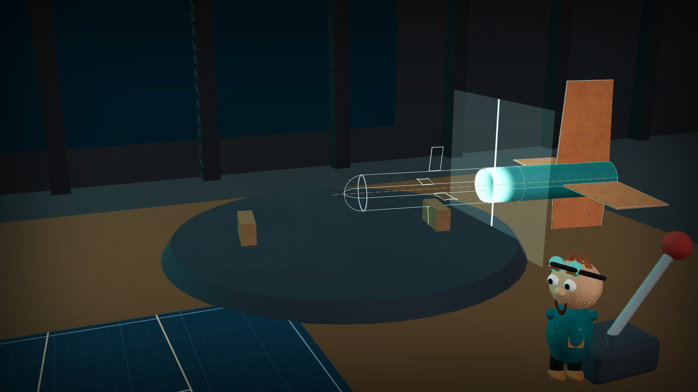
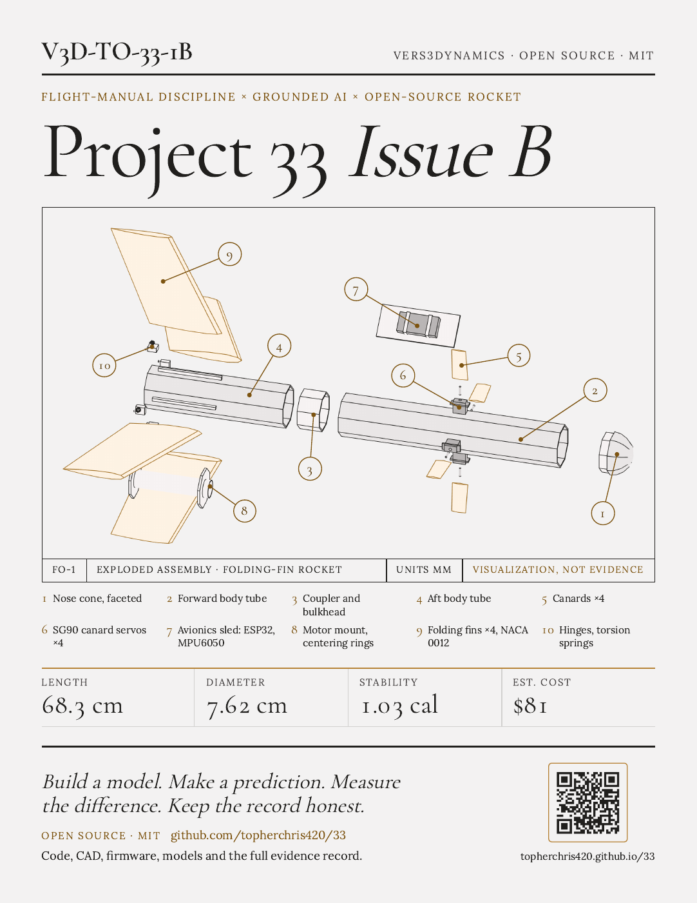
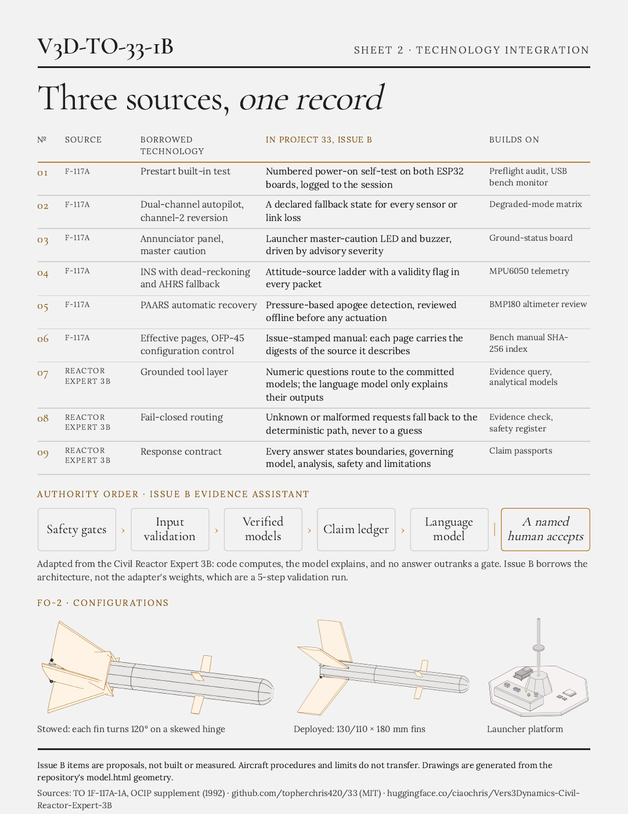
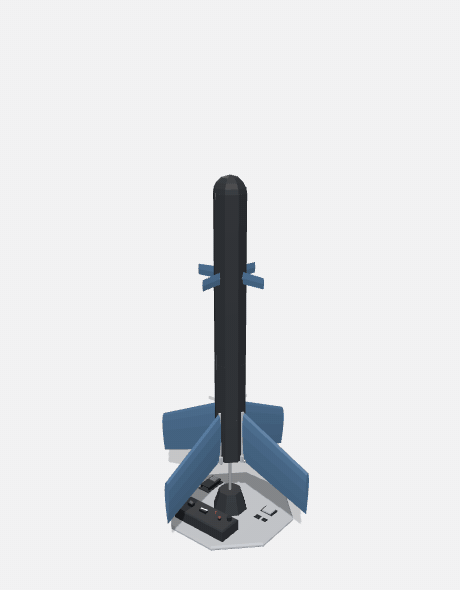

# Project 33

[](https://github.com/topherchris420/33/actions/workflows/ci.yml)
[](https://github.com/topherchris420/33/actions/workflows/marketing.yml)
[](LICENSE)

**An open engineering laboratory by Vers3Dynamics.**

Take apart a folding-fin rocket concept. Explore the models, inspect the firmware, and follow each engineering claim back to its source. Project 33 combines a tactile 3D laboratory with a reproducible evidence record: assumptions, predictions, contradictions, and the measurements still needed.

> **The rocket is the specimen. The record is the experiment.**

**[Enter the laboratory](https://topherchris420.github.io/33/lab/)** · **[Explore the 3D workbench](https://topherchris420.github.io/33/lab/workbench.html)** · **[Watch the bench manual](https://topherchris420.github.io/33/lab/bench-manual.html)** · **[Read the flier](docs/media/project33-issue-b-flier.pdf)** · **[Start here](docs/START_HERE.md)**

[](https://topherchris420.github.io/33/lab/)

*Design-file geometry rendered for the opening film. The scene illustrates the concept; it records no physical assembly or test.*

## Current status

**Bench-validation prototype.** The repository contains analytical models, CAD, ESP32 firmware, telemetry tools, and a browser laboratory. No physical measurement has been accepted into its evidence record. Flight readiness has not been established; live propulsion is outside this repository's validation boundary.

<!-- evidence:counts -->
**Record state:** 8 claims · 3 contradicted · 4 unresolved · 1 supported within stated limits · 0 accepted physical measurements · 20 open discrepancies of 27 · 5 of 5 predictions not measured.
<!-- /evidence:counts -->

The failed and disputed requirements remain visible. They define the work ahead.

## Choose your first visit

| You want to… | Start with | What you get |
|---|---|---|
| **See the idea** | [3D workbench](https://topherchris420.github.io/33/lab/workbench.html) | Rotate, explode, section, and inspect source-derived geometry |
| **Learn through exploration** | [Guided laboratory](https://topherchris420.github.io/33/lab/guided.html) | Six lessons and challenges grounded in committed data |
| **Watch the workshop** | [Utility Bench Manual film](https://topherchris420.github.io/33/lab/bench-manual.html) | A 4:09 claymation engineering companion with sound |
| **Review the research** | [Claim passports](docs/claims/README.md) and [discrepancies](docs/DISCREPANCIES.md) | Statements, assumptions, source files, and unresolved questions |
| **Reproduce the record** | [Offline review below](#reproduce-the-review) | A portable, locally verifiable review packet |
| **Contribute** | [First contribution routes](docs/START_HERE.md#make-a-useful-contribution) | Specific review questions and the checks for each kind of change |

The browser laboratory is read-only. Its values come from committed sources; synthetic data and conceptual illustrations are labeled, and unknown measurements stay **NOT MEASURED**. [How the laboratory is built](docs/LIVING_LAB.md).

## Project 33 · Issue B flier

<a href="docs/media/project33-issue-b-flier.pdf"></a>

**[Open the complete flier · PDF · 2 pages](docs/media/project33-issue-b-flier.pdf)** · **[Download original PDF](docs/media/project33-issue-b-flier.pdf?raw=1)**

An illustrated overview of the concept and its proposed technology integrations. Issue B items are proposals; dimensions, stability, and cost shown in the artwork are design or estimated values. The [claim ledger](#claim-status) records the current evidence state. [File provenance](docs/media/README.md).

<details>
<summary>Preview sheet 2: technology integration and configurations</summary>

<a href="docs/media/project33-issue-b-flier.pdf"></a>

</details>

## Reproduce the review

Python 3.11+ and Git are enough for this first workflow. After cloning, all commands below run offline with the Python standard library and require no hardware.

```bash
git clone https://github.com/topherchris420/33.git
cd 33
python -m evidence status
python -m evidence check
python -m evidence build --output build/review
python -m evidence verify build/review
```

Open `build/review/index.html` in your browser. It contains the claim assessment, copied sources, record files, provenance, and verification instructions. Choose a fresh output directory for every packet; existing reports are never overwritten. Verification checks file integrity. Scientific validity and physical performance require their own evidence.

After a revision, compare two snapshots:

```bash
python -m evidence build --output build/review-02
python -m evidence compare build/review build/review-02 --format markdown
```

The comparison identifies changed artifact bytes, record files, claim statuses, and evaluated requirement fields—even when an edited requirement still passes. Use `python -m evidence impact PATH` before an edit and `python -m evidence drift build/review` afterward to inspect affected claims. [Full review workflow and boundaries](docs/EVIDENCE_OBSERVATORY.md).

## The Living Engineering Laboratory

The laboratory gives the record a spatial form. Disassemble the machine, examine the four-bar model's closure failure, compare competing formulations, and replay synthetic telemetry with its gaps and clock domains visible.

| Room | Explore |
|---|---|
| [Workbench](https://topherchris420.github.io/33/lab/workbench.html) | Exploded assemblies, section planes, orthographic views, and source categories |
| [Mechanism Lab](https://topherchris420.github.io/33/lab/mechanism.html) | The committed linkage sweep, closure gap, and model comparisons |
| [Evidence Observatory](https://topherchris420.github.io/33/lab/observatory.html) | Claims, evidence classes, discrepancies, and grounded questions |
| [Telemetry Theater](https://topherchris420.github.io/33/lab/telemetry.html) | Replay, timing gaps, duplicate samples, filtering, and spectra |
| [Instrumentation](https://topherchris420.github.io/33/lab/instruments.html) | Stale readings, alert ages, configuration identity, and local report inspection |
| [Research Archive](https://topherchris420.github.io/33/lab/archive.html) | Capabilities, provenance, source audit, and documents |

To explore locally, run `python tools/serve_lab.py`, then open **http://localhost:8000/lab/**. This serves the committed static files; no installation or site build is needed.

### V3D-TO-33-1 · Utility Bench Manual

[](https://topherchris420.github.io/33/lab/bench-manual.html)

**[Play the complete film with sound](https://topherchris420.github.io/33/lab/bench-manual.html)** · **[Download MP4](project33-bench-manual-github-720p.mp4)** · **4:09 · 720p · 19.1 MB**

A miniature engineering workshop of annotated pages, conceptual assemblies, bench instruments, and session passports. The companion [searchable binder](https://topherchris420.github.io/33/lab/bench-manual.html#reference) has nine source-linked chapters, a glossary, printable pages, and personal reading marks. [Manual guide and source coverage](docs/UTILITY_BENCH_MANUAL.md).

The cover opens an HTML5 player on the project site; GitHub does not play repository-hosted MP4 files inline. The film is an illustrated orientation. Refer to the [claim ledger](#claim-status) for the project's evidence state.

<details>
<summary>Follow the film into the engineering record</summary>

| Sequence | Inspect the source |
|---|---|
| Description and assembly | [Architecture](docs/ARCHITECTURE.md) · [CAD assemblies](docs/CAD_ASSEMBLIES.md) |
| Offline evidence review | [Evidence Observatory](docs/EVIDENCE_OBSERVATORY.md) |
| Inert bench preflight | [Bench configuration](docs/BENCH_CONFIGURATION.md) · [Safety](docs/SAFETY.md) |
| Session passport | [Bench sessions](docs/BENCH_SESSIONS.md) · [Traceability](docs/TRACEABILITY.md) |
| Unresolved questions | [Discrepancies](docs/DISCREPANCIES.md) · [Claim passports](docs/claims/README.md) |

</details>

### Faceted 3D model

[](https://topherchris420.github.io/33/model.html)

**[Open the interactive model](https://topherchris420.github.io/33/model.html)**: drag to turn, fold and deploy the fins, explode the assembly, toggle the launcher, and download OBJ or GLB.

*The faceted skin is a visual interpretation. Some dimensions follow the OpenRocket side view rather than the `.ork` file. [Sources and assumptions](docs/MODEL_3D.md).*

<details>
<summary>More visual studies: from frequency to form</summary>

[](assets/marketing/project33-blueprint.mp4)

*Concept visualization; no physical deployment is represented as measured.*


*OpenRocket export; the model revision that produced it is not recorded (D-023).*

[Watch the 80-second opening film](https://topherchris420.github.io/33/lab/cinematic.html) · [Open the procedural tutorial](https://topherchris420.github.io/33/tutorial.html)

</details>

## Claim status

<!-- evidence:claims-table -->
**Record state:** 8 claims · 3 contradicted · 4 unresolved · 1 supported within stated limits · 0 accepted physical measurements · 20 open discrepancies of 27 · 5 of 5 predictions not measured.

| Claim | Subject | Status | Strongest accepted evidence | Failing or disputed requirements | Open discrepancies |
|---|---|---|---|---|---|
| [C1](docs/claims/C1.md) | Folding-fin mechanism model | **CONTRADICTED** | MODEL ONLY | R-C1-CLOSURE NOT SATISFIED | D-002, D-004, D-005 |
| [C2](docs/claims/C2.md) | Deployment timing | **UNRESOLVED** | IMPLEMENTATION ONLY | none failing | D-017, D-018, D-024, D-025 |
| [C3](docs/claims/C3.md) | CAD generator software | **SUPPORTED WITHIN STATED LIMITS** | IMPLEMENTATION ONLY | none failing | none |
| [C4](docs/claims/C4.md) | Material mass accounting | **UNRESOLVED** | MODEL ONLY | none failing | D-010, D-022 |
| [C5](docs/claims/C5.md) | Static-stability model | **UNRESOLVED** | MODEL ONLY | R-C5-WINDOW MODELS DISAGREE | D-006, D-007, D-008, D-009, D-023 |
| [C6](docs/claims/C6.md) | Spring margin consistency | **CONTRADICTED** | MODEL ONLY | R-C6-MARGIN NOT SATISFIED | D-009, D-010, D-011 |
| [C7](docs/claims/C7.md) | Deployment reliability evidence | **UNRESOLVED** | MODEL ONLY | none failing | D-010, D-013 |
| [C8](docs/claims/C8.md) | Structural claim boundaries | **CONTRADICTED** | MODEL ONLY | R-C8-MODULUS NOT SATISFIED | D-009, D-010, D-015 |
<!-- /evidence:claims-table -->

Each passport states the claim, its assumptions, its evidence classes, and the next measurement or review it needs. The [traceability matrix](docs/TRACEABILITY.md) connects requirements to implementations, tests, and predictions.

### Questions worth working on

| Question | Why it matters | Record |
|---|---|---|
| Which linkage topology and dimensions were intended? | The specified four-bar model fails loop closure. | [C1](docs/claims/C1.md) · D-002 |
| Which stability formulation and inputs are justified? | Two formulations disagree; source models also specify different motors. | [C5](docs/claims/C5.md) · D-006, D-007 |
| How should the spring requirement be addressed? | The modeled 19% margin is below the 20% requirement. | [C6](docs/claims/C6.md) · D-011 |
| Does the reliability model actually exercise failure cases? | The current simulation does not generate the failures it purports to count. | [C7](docs/claims/C7.md) · D-013 |


*Model output. The contradiction is retained as a result. Full context: [discrepancy register](docs/DISCREPANCIES.md).*

The next validation milestone is a human-accepted inert session with raw records, declared configuration, instrument provenance, and a passport. Timing jitter, spring rate, part masses, dry CG, gyro drift, current draw, mechanism deployment, and stiffness remain **NOT MEASURED**. [Validation roadmap](docs/ROADMAP.md).

## System components

| Component | Source | Evidence today |
|---|---|---|
| Mechanical and stability models | `mechanism/`, `materials/`, `structures/`, `Simulation/` | Analytical or simulated outputs, reproduced in CI |
| CAD and geometry tools | `CAD Files/` | Design implementation; NACA generator software-tested |
| Rocket and launcher firmware | `Firmware/Rocket/`, `Firmware/Launcher/` | Compiles in CI; physical behavior unmeasured |
| Dashboard and status board | `Firmware/dashboard.py`, `Firmware/ground_status.py` | Raw capture, replay, quality checks, and source-pinned fault interpretation |
| Standalone USB monitors | [USB instrumentation guide](docs/USB_BENCH_MONITOR.md) | Dedicated observer firmware, capture/replay, and identity diagnostics |
| Pressure data review | [Model-rocket review guide](docs/MODEL_ROCKET_REVIEW.md) | Relative-height and vertical-rate estimates, synthetic recovery markers; physical recovery unimplemented |
| Evidence Observatory | `evidence/` | Offline packets, integrity checks, claim assessment, and change impact |

[Architecture](docs/ARCHITECTURE.md) · [Protocol](docs/PROTOCOL.md) · [Wiring](docs/WIRING.md) · [Technology map](docs/TECHNOLOGY_INTEGRATION.md) · [Hardware integration plan](docs/HARDWARE_INTEGRATION_PLAN.md)

## Develop and verify

Use Python **3.11** to match CI. The standard-library review above also supports later Python versions; generated numeric fixtures can differ between versions. Create a virtual environment before installing the pinned model and test dependencies.

```bash
python -m venv .venv
```

Activate it with `source .venv/bin/activate` on Linux/macOS or `.venv\Scripts\Activate.ps1` in Windows PowerShell, then:

```bash
python -m pip install -r Firmware/requirements-test.txt -r requirements-evidence.txt
python tools/generate_protocol.py --check
python -m pytest tests Firmware/tests -q
python -m evidence reproduce
```

Run `make check` for all generated-view and record checks. `make review-full` attaches test and reproduction records to a new portable packet. For commands without Make, laboratory checks, and firmware setup, see [Testing](docs/TESTING.md) and [Start here](docs/START_HERE.md#work-on-the-project).

<details>
<summary>Firmware builds, dashboard, and bench workflow</summary>

Install PlatformIO separately with `python -m pip install -r Firmware/requirements-platformio.txt`. Copy `Firmware/Launcher/src/wifi_config.h.example` to `Firmware/Launcher/src/wifi_config.h` and configure it locally; the destination is git-ignored.

```bash
pio run -d Firmware/Rocket
pio run -d Firmware/Launcher
```

The dashboard runs with `python Firmware/dashboard.py` and requires Tkinter. It writes raw session folders under `Firmware/TestSessions/` (git-ignored). The [user guide](docs/USER_GUIDE.md) covers setup; [bench sessions](docs/BENCH_SESSIONS.md) explains declaration, passport creation, review, and human acceptance.

Prepare configuration-bound observation records with `python -m evidence bench init --output build/bench-plan`. See [bench configuration](docs/BENCH_CONFIGURATION.md) for templates, instrument provenance, and readiness packets.

For a review distribution containing firmware builds, run records, hashes, and a release-blocker report, see [release readiness](docs/RELEASE_READINESS.md). Fusion users can install the script with `python tools/install_fusion_script.py` and run `Project33NacaFin` from **Utilities → Scripts and Add-Ins**.

</details>

## Cost

<!-- evidence:cost -->
Estimated prototype subtotal: **$81** from 10 BOM lines (10 estimates, 0 purchased prices recorded, source dates not recorded, shipping and spares excluded). An estimate is not a purchase record; see [BOM](docs/BOM.md) and D-021.
<!-- /evidence:cost -->

## Contribute

A useful contribution closes a specific uncertainty: reproduce a discrepancy, inspect an assumption, improve a test, clarify a source, or propose an inert experiment. The [contribution guide](CONTRIBUTING.md) describes record rules and review requirements; [Start here](docs/START_HERE.md#make-a-useful-contribution) maps tasks to the relevant sources.

The project advances through **analytical model → software reproduction → synthetic test → inert bench setup → inert physical measurement → repeated measurement → independent review**. Physical evidence requires named human acceptance. Automated tools may interpret the record and propose experiments; they cannot accept sessions or invent measurements. [Safety boundary](docs/SAFETY.md).

<details>
<summary>Repository map</summary>

| Path | Purpose |
|---|---|
| `evidence/` | Claim catalog, requirements, predictions, sessions, measurements, reviews, and failure archive |
| `docs/claims/` | Generated claim passports |
| `docs/TRACEABILITY.md`, `docs/DISCREPANCIES.md` | Generated requirement, prediction, and discrepancy views |
| `docs/EVIDENCE/` | Committed model outputs and plots |
| `mechanism/`, `materials/`, `structures/`, `Simulation/` | Analytical and simulation models |
| `CAD Files/` | Fusion archives, geometry generators, and scripts |
| `Firmware/` | ESP32 firmware, dashboard, status board, and tests |
| `protocol/` | Canonical protocol and source-pinned status model |
| `tools/` | Generators, checkers, laboratory server, and packaging |
| `lab/` | Static engineering laboratory and derived data views |
| `tests/` | Regression, adversarial, mathematical, and browser checks |

</details>

Project 33 is published under the [MIT License](LICENSE).

**[Project site](https://topherchris420.github.io/33/)** · **[Project status](docs/PROJECT_STATUS.md)** · **[Paper alignment](docs/PAPER_ALIGNMENT.md)** · **[Roadmap](docs/ROADMAP.md)** · **[Report a security issue](SECURITY.md)**

*Build a model. Make a prediction. Measure the difference. Keep the record honest.*
