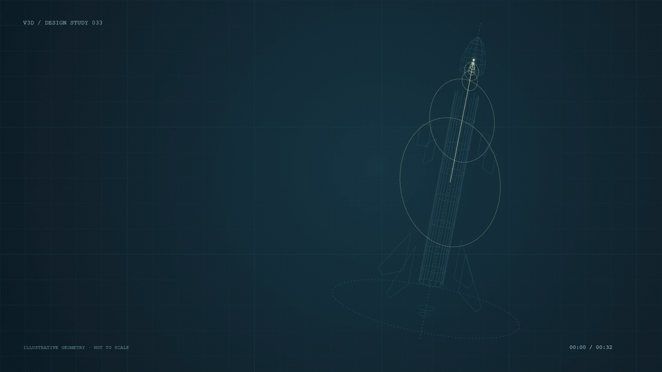
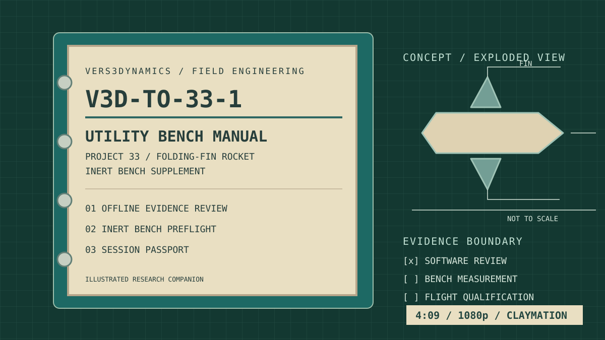
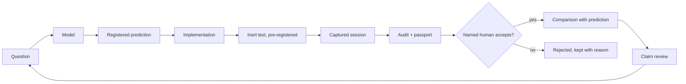
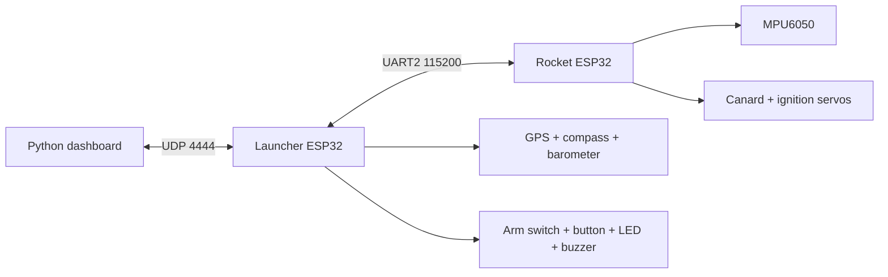
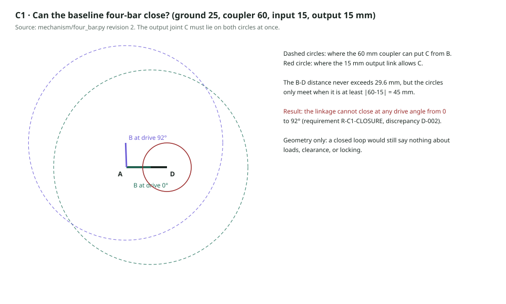
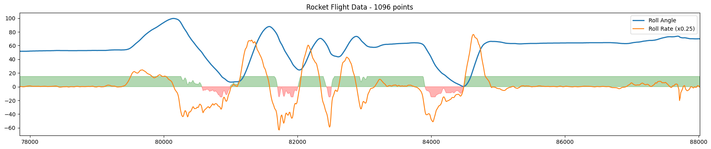

# Project 33

[](https://github.com/topherchris420/33/actions/workflows/ci.yml)
[](LICENSE)

**Vers3Dynamics | Applied Aerospace Research · Open Source · Evidence First**

> **The rocket is the specimen. The record of what we know, what we think we know, and what we have yet to measure is the experiment.**

Project 33 investigates a low-cost folding-fin rocket concept through mechanical analysis, CAD, embedded firmware, telemetry software, and reproducible research. But the more ambitious project is an **engineering evidence system**: a way to carry a claim from assumption to model, from model to implementation, and eventually from observation to independent review without confusing those stages.

**[Explore the project](https://topherchris420.github.io/33/)** · **[Watch the utility bench manual](#v3d-to-33-1--utility-bench-manual)** · **[Reproduce an offline review](#reproduce-the-review)** · **[Inspect the claim ledger](#claim-status)** · **[Read the roadmap](docs/ROADMAP.md)** · **[Contribute](CONTRIBUTING.md)**

## From frequency to form

[](assets/marketing/project33-blueprint.mp4)

*Design visualization, not a flight test, physical assembly record, or evidence of deployment.*

**[Turn the faceted 3D model in your browser](https://topherchris420.github.io/33/model.html)**: deployed and folded fins, exploded and assembled views, the launcher platform, and OBJ/GLB download. Also a design visualization, not evidence; [sources and assumptions](docs/MODEL_3D.md).

## V3D-TO-33-1 · Utility Bench Manual

[](project33-bench-manual-github-720p.mp4)

**[▶ Watch the complete film](project33-bench-manual-github-720p.mp4)** · **[Direct MP4](https://raw.githubusercontent.com/topherchris420/33/main/project33-bench-manual-github-720p.mp4)** · **4:09 · 720p · 19.1 MB**

**A 4:09 claymation engineering companion.** The repository hosts the optimized **720p MP4**, preserved from the original 1080p master. This miniature workshop turns Project 33's research record into a tactile technical manual: annotated pages, conceptual rocket assemblies, bench instruments, operator checklists, and a session-passport workflow. The visual language borrows from vintage utility manuals while keeping the actual engineering boundaries visible.

| Film sequence | What it illustrates | Inspect the source |
|---|---|---|
| **Description and assembly** | The conceptual folding-fin rocket and its subsystems; exploded views are illustrative, not dimensioned CAD | [Architecture](docs/ARCHITECTURE.md) · [CAD assemblies](docs/CAD_ASSEMBLIES.md) |
| **Offline evidence review** | Reproducible, hardware-free checks and a portable review packet | [Reproduce the review](#reproduce-the-review) · [Evidence Observatory](docs/EVIDENCE_OBSERVATORY.md) |
| **Inert bench preflight** | A clearly bounded, non-energetic preparation workflow and source-based safety checks | [Bench configuration](docs/BENCH_CONFIGURATION.md) · [Safety](docs/SAFETY.md) |
| **Session passport** | Provenance, raw records, review, and the requirement for named human acceptance | [Bench sessions](docs/BENCH_SESSIONS.md) · [Traceability](docs/TRACEABILITY.md) |
| **What remains unresolved** | Contradicted model assumptions, unmet margins, and the gap between an animation and physical evidence | [Discrepancy register](docs/DISCREPANCIES.md) · [Claim passports](docs/claims/README.md) |

**How to read the film:** It is a visual orientation and interpretive tutorial, **not** footage of an assembled flight article, a validated test, or a demonstration of flight readiness. A rendered deployment is not a measured deployment. The [claim ledger](#claim-status) remains the authority on the project's evidence state.

**Film access:** Select the illustrated cover or the watch link above to open the complete MP4. The direct file link is also available for downloading or viewing in a compatible browser.

## Current status

Project 33 is a **bench-validation prototype**. It has models, CAD, firmware that compiles, a telemetry dashboard, and automated checks. **No physical measurement has been accepted into the evidence record.** Nothing here is flight-tested or flight-ready, and live propulsion is outside the repository's validation boundary.

<!-- evidence:counts -->
**Record state:** 8 claims · 3 contradicted · 4 unresolved · 1 supported within stated limits · 0 accepted physical measurements · 18 open discrepancies of 25 · 5 of 5 predictions not measured.
<!-- /evidence:counts -->

Unresolved is a valid engineering state. Several research claims are currently contradicted by their own models, and saying so is the point.

### At a glance

| Exists in the repository | Not yet established |
|---|---|
| OpenRocket and analytical models | An independently validated flight or stability model |
| Fusion 360 archives and a software-tested CAD generator | A measured, assembled folding-fin mechanism |
| ESP32 firmware that compiles in CI | Hardware behavior demonstrated on physical boards |
| A dashboard tested with synthetic telemetry | Any human-accepted inert physical measurement |
| Traceable claims, discrepancies, and offline review packets | Live-propulsion safety or flight readiness |

### Where to begin

| Your interest | Start here |
|---|---|
| **The concept and visuals** | [Live project page](https://topherchris420.github.io/33/), [3D model](https://topherchris420.github.io/33/model.html) and [architecture](docs/ARCHITECTURE.md) |
| **The scientific record** | [Claim passports](docs/claims/README.md), [traceability](docs/TRACEABILITY.md), and [discrepancies](docs/DISCREPANCIES.md) |
| **Reproducibility** | [Offline review commands](#reproduce-the-review) and [Evidence Observatory](docs/EVIDENCE_OBSERVATORY.md) |
| **Working on the project** | [Roadmap](docs/ROADMAP.md), [tests](docs/TESTING.md), and [contribution guide](CONTRIBUTING.md) |

## Why evidence is the real instrument

A rendered rocket can look complete while its underlying questions remain unanswered. Project 33 refuses to treat a visualization as a measurement or a clean simulation as a qualification result. For every consequential engineering statement, the project asks:

- **What is being claimed?** The scope must be narrow enough to test, not a declaration of success.
- **Where is its provenance?** Exact sources, derived artifacts, and SHA-256 digests must remain inspectable.
- **What could disprove it?** Requirements, competing formulations, discrepancies, and preregistered predictions stay visible.
- **Who accepts the evidence?** Automation can organize records; only a named human can accept physical observations and advance their review.

That philosophy is a practical research design. It lets a future reviewer distinguish what the team intended, what software actually demonstrated, and what the physical world has not yet answered.

## Evidence Observatory

The [Evidence Observatory](docs/EVIDENCE_OBSERVATORY.md) (`evidence/`, Python standard library only, fully offline) is the centre of the project. For every claim it answers:

- **What is claimed?** A passport per claim: question, current statement, status, assumptions, limitations.
- **What stands behind it, and what kind of evidence is that?** Exact files with SHA-256 digests, each classed on an evidence ladder: specification, implementation, test procedure, synthetic, analytical, simulated, software verified, bench observed, bench measured.
- **Does it meet its requirements?** Machine-checkable requirements are evaluated from committed values and labeled with the evidence class they came from: *SATISFIED (analytical)* is not *SATISFIED (bench measured)*.
- **What disagrees?** A [discrepancy register](docs/DISCREPANCIES.md) of recorded mismatches between models, requirements, documentation, firmware, CAD, and the BOM.
- **What is still unknown?** Predictions frozen before measurement, shown as **NOT MEASURED**, never zero.
- **What changed, and which reviews are no longer sufficient?** Dependency tracking marks a claim's review stale when any file it rests on changes, without declaring the claim false.

Support is derived, never authored: a model cannot become a measurement, synthetic data cannot be relabeled as physical, and no claim can be promoted past a validation gate without a human-accepted inert measurement. The tooling refuses to build a report from a record that tries.

## The engineering loop



Software may propose an inert experiment and check it against machine-readable rules. A human decides whether to perform it. Only the resulting measurement, accepted by a named reviewer, enters the record. Confidence is not authority.

## System components

| Component | What it is | Evidence it carries today |
|---|---|---|
| OpenRocket model + static-margin scripts | `Simulation/` | Analytical; two formulations disagree (D-006) |
| Mechanism, spring, mass, structural models | `mechanism/`, `materials/`, `structures/` | Analytical/simulated; reproduced in CI |
| Fusion 360 archives + CAD generators | `CAD Files/` | Implementation; NACA generator software-tested |
| Rocket flight computer (ESP32) | `Firmware/Rocket/` | Compiles in CI; no bench capture |
| Launcher ground station (ESP32) | `Firmware/Launcher/` | Compiles in CI; interlocks source-checked, not bench-verified |
| Telemetry dashboard | `Firmware/dashboard.py` | Writes raw sessions with metadata, command log, and quality counters |
| Status board | `Firmware/ground_status.py`, `Firmware/status_panel.py` | Read-only fault isolation pinned to firmware source; tested on synthetic packets, no fault injected on hardware |
| Evidence Observatory | `evidence/` | Portable review packets, session passports, record checks |



Details: [Architecture](docs/ARCHITECTURE.md) · [Protocol](docs/PROTOCOL.md) · [Wiring](docs/WIRING.md).

## Claim status

<!-- evidence:claims-table -->
**Record state:** 8 claims · 3 contradicted · 4 unresolved · 1 supported within stated limits · 0 accepted physical measurements · 18 open discrepancies of 25 · 5 of 5 predictions not measured.

| Claim | Subject | Status | Strongest accepted evidence | Failing or disputed requirements | Open discrepancies |
|---|---|---|---|---|---|
| [C1](docs/claims/C1.md) | Folding-fin mechanism model | **CONTRADICTED** | MODEL ONLY | R-C1-CLOSURE NOT SATISFIED | D-002, D-004, D-005 |
| [C2](docs/claims/C2.md) | Deployment timing | **UNRESOLVED** | IMPLEMENTATION ONLY | none failing | D-017, D-018, D-024, D-025 |
| [C3](docs/claims/C3.md) | CAD generator software | **SUPPORTED WITHIN STATED LIMITS** | IMPLEMENTATION ONLY | none failing | none |
| [C4](docs/claims/C4.md) | Material mass accounting | **UNRESOLVED** | MODEL ONLY | none failing | D-010, D-022 |
| [C5](docs/claims/C5.md) | Static-stability model | **UNRESOLVED** | MODEL ONLY | R-C5-WINDOW MODELS DISAGREE | D-006, D-007, D-008, D-009, D-023 |
| [C6](docs/claims/C6.md) | Spring margin consistency | **CONTRADICTED** | MODEL ONLY | R-C6-MARGIN NOT SATISFIED | D-009, D-010, D-011 |
| [C7](docs/claims/C7.md) | Deployment reliability evidence | **UNRESOLVED** | MODEL ONLY | none failing | D-010, D-013 |
| [C8](docs/claims/C8.md) | Structural claim boundaries | **CONTRADICTED** | MODEL ONLY | R-C8-MODULUS NOT SATISFIED | D-009, D-010, D-015 |
<!-- /evidence:claims-table -->

Each claim links to a generated passport. The full requirement matrix and prediction ledger are in [Traceability](docs/TRACEABILITY.md).

### Read the contradictions, not just the successes

Four examples show why the ledger exists:

- **C1 (mechanism):** The specified four-bar linkage fails its loop-closure test. The intended topology requires review ([D-002](docs/DISCREPANCIES.md)).
- **C5 (stability):** Two formulations disagree, while the reference script and OpenRocket file specify different motors ([D-006 and D-007](docs/DISCREPANCIES.md)).
- **C6 (spring):** A modeled margin of **19%** falls below its **20%** requirement. The record retains the failed requirement ([D-011](docs/DISCREPANCIES.md)).
- **C7 (reliability):** The current simulation does not generate the failure cases it purports to count ([D-013](docs/DISCREPANCIES.md)).



*Analytical geometry output, not a physical deployment photograph. The contradiction is part of the result.*

## What has actually been demonstrated

Only software-level facts, each with a named scope:

- **Firmware builds:** both PlatformIO projects compile in CI. Compiling is not hardware behavior.
- **Software tests:** the Python suite passes in CI; CI review packets attach the JUnit run record.
- **Model reproduction:** every committed model output regenerates from source and matches by value (`python -m evidence reproduce`).
- **Record consistency:** requirements, predictions, reviews, archive digests, and generated documents agree (`python -m evidence check`).
- **Interlocks are implemented in source:** every gate in the registry is pinned to exact source lines by tests ([Safety](docs/SAFETY.md)).

## What has not been measured

Everything physical. Timing jitter, spring rate, part masses, dry CG, servo authority, gyro drift, current draw, interlock behavior on hardware, mechanism deployment, and stiffness are all **NOT MEASURED**. Inert experiments are drafted as pre-registrations awaiting adoption by a human (P-001 timing, P-002 spring rate, P-003 drift).

## Reproduce the review

**This is the safest first experiment.** With Python 3.11 or newer, you can inspect the complete evidence record and generate a portable report without connecting hardware, accessing a network, or installing third-party Python packages.

From a local checkout of this repository:

```bash
python -m evidence status                          # claim table, requirement results, scopes
python -m evidence check                           # strict: drift, stale reviews, stale generated docs
python -m evidence build --output build/review     # portable packet: open build/review/index.html
python -m evidence verify build/review             # integrity only; not scientific validity
python -m evidence query                           # grounded evidence questions
python -m evidence impact mechanism/spring_sizing.py   # what a change would affect
```

With the model dependencies installed (`python -m pip install -r requirements-evidence.txt`), `python -m evidence reproduce` regenerates committed model outputs in a temporary directory and compares their values. `make review-full` builds a packet with test and reproduction run records attached.

Open `build/review/index.html` locally to explore the result. If that output folder already exists, choose a fresh path: the packet builder intentionally does not overwrite previous reports. **Verification confirms packet integrity, not scientific validity or physical performance.**

## Validation roadmap

The project moves only through explicit gates: **analytical model → software reproduction → synthetic test → inert bench setup → inert physical measurement → repeated measurement → independent review.** Gates from inert bench setup onward need a human-registered pre-registration or a human-accepted measurement. No AI model, CI run, or repository setting can move a claim across them. Next steps are in the [Roadmap](docs/ROADMAP.md); the readiness matrix is in [Project Status](docs/PROJECT_STATUS.md).

## Safety boundary

This repository is for inert bench validation, simulation, and engineering review. Dashboard launch is rejected by default in firmware; the physical arming switch, readiness handshake, heartbeat timeout, and rocket-side arming state all stay in force, and refusals are logged. Automated tools, including AI assistants, may interpret the record; they may not create measurements, accept sessions, or touch any safety gate. See [Safety](docs/SAFETY.md). Field testing is a separate, safety-reviewed process outside this repository.

## Repository map

| Path | Purpose |
|------|---------|
| `evidence/` | Evidence Observatory: claim catalog, requirements, predictions, measurements, discrepancies, sessions, pre-registrations, reviews, failure archive, reviewer code |
| `docs/claims/` | Generated claim passports |
| `docs/TRACEABILITY.md`, `docs/DISCREPANCIES.md` | Generated requirement matrix, prediction ledger, discrepancy register, failure archive |
| `docs/EVIDENCE/` | Committed model outputs (JSON/CSV) and rendered plots |
| `mechanism/`, `materials/`, `structures/`, `Simulation/` | Analytical and simulation models |
| `CAD Files/` | Fusion 360 archives, NACA fin generator, Fusion scripts |
| `Firmware/Rocket/`, `Firmware/Launcher/` | PlatformIO firmware |
| `Firmware/dashboard.py` | Tkinter telemetry dashboard (raw session capture) |
| `Firmware/ground_status.py`, `Firmware/status_panel.py` | Read-only [status board](docs/GROUND_STATUS.md): fault isolation, attitude, gain confirmation, advisories, session replay |
| `protocol/ground_status_model.json` | Source-pinned dependency model; generates [Degraded Modes](docs/DEGRADED_MODES.md) |
| `protocol/` | Canonical protocol definition; generates the firmware header and [Protocol](docs/PROTOCOL.md) |
| `tools/` | Protocol generator, documentation link checker, review figures, Fusion script installer |
| `tests/`, `Firmware/tests/` | Regression and adversarial tests |

## Build and run

```bash
python -m pip install -r Firmware/requirements-test.txt
python tools/generate_protocol.py --check
python -m pytest tests Firmware/tests -q
```

Firmware (create the local WiFi header first; it is git-ignored):

```bash
cp Firmware/Launcher/src/wifi_config.h.example Firmware/Launcher/src/wifi_config.h
pio run -d Firmware/Rocket
pio run -d Firmware/Launcher
```

Dashboard: `python -m pip install -r Firmware/requirements.txt`, then `python Firmware/dashboard.py`. Each run writes a raw session folder under `Firmware/TestSessions/` (git-ignored); see [Bench Sessions](docs/BENCH_SESSIONS.md) for turning a run into reviewable evidence.

For an inert review distribution with both firmware builds, software run records, source, hashes, and an explicit release-blocker report, run `python tools/finalize_release.py --output dist`. Exit 1 means the review package was created with unresolved blockers; it does not authorize deployment. See [User Guide](docs/USER_GUIDE.md) and [Release Readiness](docs/RELEASE_READINESS.md). The separate synthetic fixture generator exercises the dashboard CSV format without creating bench evidence or purchase records.

To prepare configuration-bound observation records, start with `python -m evidence bench init --output build/bench-plan`. The [bench configuration guide](docs/BENCH_CONFIGURATION.md) covers empty observation templates, raw instrument provenance, unit/source checks, and portable readiness packets. Missing measurements remain unknown; no session is automatically accepted.

Fusion 360 script: `python tools/install_fusion_script.py`, then run `Project33NacaFin` from **Utilities -> Scripts and Add-Ins**.

## Cost

<!-- evidence:cost -->
Estimated prototype subtotal: **$81** from 10 BOM lines (10 estimates, 0 purchased prices recorded, source dates not recorded, shipping and spares excluded). An estimate is not a purchase record; see [BOM](docs/BOM.md) and D-021.
<!-- /evidence:cost -->



*OpenRocket export; the model revision that produced it is not recorded (D-023).*

## Contribute to the questions, not just the code

A useful contribution might be a reproducible discrepancy, a better model assumption, an adversarial software test, a clearer limitation, or a carefully specified inert-test proposal. Read [CONTRIBUTING.md](CONTRIBUTING.md) before opening a pull request. Preserve generated evidence sections, document the checks you ran, and never promote synthetic or modeled observations into physical evidence.

Project 33 is published under the [MIT License](LICENSE). The code and evidence record are open for inspection and improvement; the validation boundary remains explicit.

**[Project site](https://topherchris420.github.io/33/)** · **[Project Status](docs/PROJECT_STATUS.md)** · **[Evidence Observatory](docs/EVIDENCE_OBSERVATORY.md)** · **[Paper Alignment](docs/PAPER_ALIGNMENT.md)** · **[Roadmap](docs/ROADMAP.md)** · **[Safety](docs/SAFETY.md)**

*Build a model. Make a prediction. Measure the difference. Keep the record honest.*
