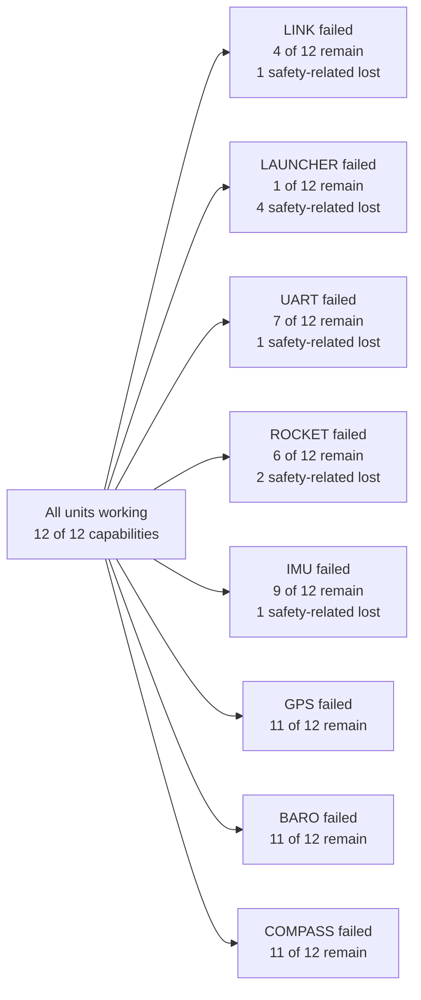

# Degraded Modes

Generated by `tools/generate_degraded_modes.py` from `protocol/ground_status_model.json`. Do not edit by hand.

**Evidence class: analytical.** This exhausts all 256 combinations of 8 failed units in a dependency model pinned to firmware source. It shows what the firmware's structure implies. No fault has been injected on hardware, so every entry's bench evidence is **NOT MEASURED**. See [Ground Status](GROUND_STATUS.md) for how the board uses this.

## What each single failure leaves

`x` means the capability is lost when that unit fails. Rows marked **S** are safety-related.

| Capability | S | LINK | LAUNCHER | UART | ROCKET | IMU | GPS | BARO | COMPASS |
|---|---|---|---|---|---|---|---|---|---|
| Arming switch returns the launcher to SAFE | **S** |  | x |  |  |  |  |  |  |
| Launcher aborts READY on lost rocket heartbeat | **S** |  | x |  |  |  |  |  |  |
| Rocket centers canards and holds ignition off without an IMU | **S** |  |  |  | x |  |  |  |  |
| Launcher can reach READY | **S** |  | x | x | x | x |  |  |  |
| Abort reasons reach the session record | **S** | x | x |  |  |  |  |  |  |
| Live roll, rate, servo, and state on the dashboard |  | x | x | x | x | x |  |  |  |
| Onboard log dump can be requested and received |  | x | x | x | x |  |  |  |  |
| Controller gains can be changed |  | x | x | x | x |  |  |  |  |
| A gain change can be confirmed by telemetry |  | x | x | x | x | x |  |  |  |
| Launcher position on the dashboard |  | x | x |  |  |  | x |  |  |
| Barometric altitude on the dashboard |  | x | x |  |  |  |  | x |  |
| Launcher heading on the dashboard |  | x | x |  |  |  |  |  | x |

### Why each dependency holds

| Capability | Reason |
|---|---|
| Arming switch returns the launcher to SAFE | Gate G-01 runs on the launcher alone; the dashboard and rocket are not involved. |
| Launcher aborts READY on lost rocket heartbeat | Gate G-03 is the launcher's response to losing the rocket, so it survives UART, rocket, and IMU faults. |
| Rocket centers canards and holds ignition off without an IMU | The rocket's failed-IMU branch needs only the rocket processor. |
| Launcher can reach READY | Gate G-02 needs a rocket READY line, and the rocket suppresses READY without an IMU. The dashboard link is not required. |
| Abort reasons reach the session record | The launcher still aborts without a link, but the reason then never reaches the dashboard CSV. |
| Live roll, rate, servo, and state on the dashboard | Same path as the rocket telemetry channel. |
| Onboard log dump can be requested and received | Same path as the log-dump reply; a rocket whose IMU failed at boot answers with an empty log. |
| Controller gains can be changed | The launcher forwards valid PID lines and the rocket applies them before its IMU check. |
| A gain change can be confirmed by telemetry | Firmware sends no acknowledgement; only STATUS shows the active gains, and STATUS needs the IMU path. |
| Launcher position on the dashboard | Latitude and longitude are placeholders unless gps_state is 2. |
| Barometric altitude on the dashboard | Same path as the altitude channel. |
| Launcher heading on the dashboard | Same path as the heading channel. Its tilt correction also reads relayed rocket IMU values, which stay zero without rocket telemetry. |

## What the dashboard can tell apart

A fault can only be isolated if it changes what the dashboard observes. Grouping failure sets by observable signature shows the limits. The log-dump probe is the existing `dumplog` command, sent by the operator.

| Observation | Distinct signatures | Failure sets |
|---|---|---|
| Passive, packets only | 17 | 256 |
| With the log-dump probe | 25 | 256 |

Single failures that look identical:

| Observation | Cannot be separated |
|---|---|
| Passive, packets only | IMU, ROCKET, UART |
| Passive, packets only | LAUNCHER, LINK |
| With the log-dump probe | LAUNCHER, LINK |
| With the log-dump probe | ROCKET, UART |

With the probe, a second failure each of these hides from the dashboard:

| After this fails | These can also have failed unnoticed |
|---|---|
| LINK | BARO, COMPASS, GPS, IMU, LAUNCHER, ROCKET, UART |
| LAUNCHER | BARO, COMPASS, GPS, IMU, LINK, ROCKET, UART |
| UART | IMU, ROCKET |
| ROCKET | IMU, UART |
| IMU | none |
| GPS | none |
| BARO | none |
| COMPASS | none |

## Channels

| Packet stream | Needs | Reason |
|---|---|---|
| Rocket telemetry (T + STATUS) | LINK, LAUNCHER, UART, ROCKET, IMU | The launcher relays T and STATUS only from a rocket DATA line, and the rocket loop returns before DATA when the MPU6050 failed at boot. |
| Launcher environment (ENV) | LINK, LAUNCHER | ENV is sent once a second from the tail of the launcher main loop, so it pauses while the launcher waits inside the arming window, the ignition wait, or the abort latch. |
| Launcher heading ([FUSION]) | LINK, LAUNCHER, COMPASS | A compass reading of all zeros returns before the [FUSION] packet. It shares the loop tail with ENV, so it is only meaningful while ENV is flowing. |
| GPS NMEA stream (ENV gps_state above 0) | LINK, LAUNCHER, GPS | gps_state is 0 when no GPS characters arrived since the previous ENV. |
| Barometric altitude (ENV alt finite) | LINK, LAUNCHER, BARO | The launcher sends nan when the barometer failed at boot. |
| Log-dump reply (LOG_START ... LOG_END) | LINK, LAUNCHER, UART, ROCKET | The rocket handles commands before its MPU6050 check, so a rocket with a failed IMU still answers DUMPLOG. That reply separates an IMU fault from a UART or rocket fault. |

## Capabilities the firmware does not have

Pinned so that adding one fails a test and forces this model and the board to be updated.

| Missing | Why it matters |
|---|---|
| Returning an armed rocket to IDLE without a restart | The only IDLE assignment in the rocket firmware is its initial value, and the launcher's abort path sends the rocket nothing. See discrepancy D-025. |
| The launcher reporting SAFE, ARMING, READY, or IGNITING to the dashboard | STATUS carries the rocket's state. The dashboard can only infer the launcher's state. |
| A rocket heartbeat that does not depend on the IMU | The launcher accepts an ALIVE line as a heartbeat, but the rocket never sends one, so a failed IMU looks the same as a dead rocket until a log dump is requested. |

## Advisories

| ID | Level | Meaning |
|---|---|---|
| `W-ARMED-AFTER-ABORT` | WARNING | The launcher aborted and the rocket still reports an active state. A launcher abort does not disarm the rocket, the launcher cannot re-arm it, and only a rocket restart returns it to IDLE (D-025). |
| `W-ACTIVE-STATE-STALE` | WARNING | The rocket last reported an active state and telemetry has stopped. Its state is unknown; loss of telemetry is not a safe indication. |
| `W-IGNITION-ACTUATION` | WARNING | The rocket reports IGNITING or FLIGHT, so the ignition servo was commanded. FLIGHT does not confirm ignition. On the bench the servo must be mechanically disconnected. |
| `C-NO-PACKETS` | CAUTION | Nothing is arriving from the launcher. |
| `C-ROCKET-TELEMETRY-LOST` | CAUTION | The launcher is reporting but rocket telemetry has stopped. |
| `C-LAUNCHER-ABORT` | CAUTION | The launcher reported an abort. Shown for 30 s. |
| `C-GAINS-NO-MATCH` | CAUTION | Telemetry is flowing and still shows different gains from the ones sent. |
| `C-GAINS-REJECTED` | CAUTION | A board rejected the gains that were sent. |
| `C-ROCKET-RESTART` | CAUTION | Rocket state moved backwards, skew changed while IDLE with no calibration to explain it, or the rocket clock fell behind ground time between log dumps. Firmware has no other path to these, so a restart or brownout is inferred. A restart also returns gains to their defaults, zeroes roll, and loses the onboard log. Shown for 30 s. |
| `C-LAUNCHER-RESTART` | CAUTION | The launcher clock went backwards, so a restart or brownout is inferred. Shown for 30 s. |
| `C-OUTPUT-OUTSIDE-FLIGHT` | CAUTION | A non-zero servo output arrived outside FLIGHT, which firmware should not produce. Check the firmware and protocol revision. |
| `C-STATE-UNKNOWN` | CAUTION | STATUS carried a state this model does not know. Check the firmware and protocol revision. |
| `C-UNKNOWN-COMMAND` | CAUTION | The launcher did not recognize a dashboard command. Check the firmware and protocol revision. Shown for 30 s. |
| `A-LAUNCHER-HELD` | ADVISORY | Rocket telemetry is flowing but ENV has paused, so the launcher is inside a wait: arming window, ignition wait, or abort latch. |
| `A-GPS-NO-NMEA` | ADVISORY | ENV reports no characters from the GPS module. |
| `A-GPS-NO-FIX` | ADVISORY | GPS is sending sentences without a fix. Position is unavailable, not zero. |
| `A-BARO-MISSING` | ADVISORY | ENV reports no barometer. Altitude is unavailable, not zero. |
| `A-COMPASS-SILENT` | ADVISORY | ENV is flowing without [FUSION], which is what a compass reading all zeros produces. |
| `A-IMU-FROZEN` | ADVISORY | Roll and rate have been identical for about 2 s. The firmware does not detect a sensor failure after boot; this threshold is a heuristic because sensor noise is not measured. |
| `A-CANARD-LIMIT` | ADVISORY | The servo output is at the firmware deflection limit. |
| `A-COMMAND-REFUSED` | ADVISORY | A board refused a command. The default refusal of dashboard launch is expected. Shown for 30 s. |
| `A-GAINS-UNCONFIRMED` | ADVISORY | Gains were sent and no telemetry arrived to confirm them. |
| `A-ROLL-REFERENCE-WEAK` | ADVISORY | The rocket's body axis is within 5 degrees of vertical, so little gravity falls on the two axes firmware uses to correct roll, and error on them is magnified by 1/cos(pitch) (D-026). The threshold is a heuristic because sensor noise is not measured. |
| `A-CALIBRATION-NO-CHANGE` | ADVISORY | Calibration was sent and telemetry is flowing, but skew did not change. This is not a refusal: firmware sends no reply, and skew is reported to 0.01 deg, so a recalibration can land on the same value. Shown for 30 s. |
| `A-LOG-PARTIAL` | ADVISORY | A log dump ended with a different row count from the one it announced. Shown for 30 s. |
| `A-PROBE-UNANSWERED` | ADVISORY | A log dump got no reply while telemetry shows the path working, so the command or reply was probably lost; UDP does not guarantee delivery. |

## Not modeled

- Sensor failure after boot: mpuHealthy and bmpHealthy are set only in setup(), so firmware keeps reporting whatever the driver returns. The IMU-frozen advisory is a heuristic for the rocket side; nothing covers the barometer.
- Partial faults: a slow, noisy, or intermittent unit is modeled as working while its packets arrive on time.
- One-way link faults: LINK and UART are each treated as a single unit, not two directions.
- Common causes: a shared supply or I2C bus is not a unit, so a brownout appears as several unit failures.
- A rocket restart while IDLE whose new skew rounds to the old value: nothing changes in the packets until a later log dump shows the rocket clock behind ground time, and that needs a dump from before the restart.
- Whether firmware is applying its accelerometer correction at any moment: that depends on total acceleration, which is not in the dashboard protocol. The roll reference describes pose geometry only.
