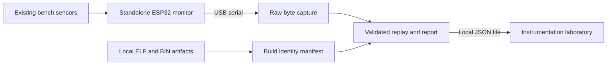

# Standalone USB bench instrumentation

Project 33 now includes working ESP32 monitoring firmware and a capture/replay
path into the [instrumentation laboratory](../lab/instruments.html). It implements
equipment identification, sensor observation, explicit invalid data, reset and
memory diagnostics, sequence checking, and configuration comparison.

These are dedicated monitor images for a stationary bench specimen. The monitor
source has no servo, deployment, launcher command, WiFi or rocket-relay interface.
It replaces the application installed on a board; it is not an extension of the
existing control loop. The existing `rocket` and `launcher` images remain the
default build environments.

## Implemented data path



The rocket monitor reads the MPU6050's acceleration, angular rate and temperature.
The launcher monitor reads BMP180 temperature/pressure, QMC5883L raw magnetic
counts, and GPS position when the receiver reports a sufficiently recent fix.
No heading, navigation solution or flight-control output is computed.

Each image also reports a boot nonce, uptime, sequence number, reset-reason code,
free/minimum heap, and the ELF digest embedded by the build system. The wire
definition and quantity units live in [bench_monitor.json](../protocol/bench_monitor.json).

## Build without connecting hardware

```text
python -m pip install -r Firmware/requirements-platformio.txt
pio run -d Firmware/Rocket -e rocket_monitor
pio run -d Firmware/Launcher -e launcher_monitor
```

The monitor environments select only `src/bench_monitor.cpp`; they exclude the
normal main and deployment translation units. Neither defines `BENCH_MODE`.
CI compiles both default images and both monitor images. Software tests check
the environment isolation and parser behavior; builds alone establish no
physical behavior.

The firmware CI job retains a `project33-usb-monitors-<commit>` artifact with both
monitor build outputs and identity manifests, plus these instructions.

The project wiring reference supplies the existing sensor connections. No new
power-monitoring circuit or electrical limit is inferred from the aircraft
manual. A responsible human must choose the actual inert configuration and
review the installed image before any hardware work. No upload was performed
by this change.

## Preserve build identities

For example, generate a manifest from the rocket monitor build:

```text
python Firmware/bench_monitor.py manifest --role rocket --elf Firmware/Rocket/.pio/build/rocket_monitor/firmware.elf --binary Firmware/Rocket/.pio/build/rocket_monitor/firmware.bin --output build/rocket-monitor.json
```

This saves the build manifest without overwriting an existing file. Repeat for the launcher with the
corresponding paths. `elf_sha256` identifies the ELF file; `binary_sha256`
identifies the BIN artifact. The value reported by the board is the ELF digest,
not the BIN digest. A matching declaration does not authenticate the device or
prove that an entire flashed image was read back.

## Exercise the complete software path offline

Choose a new output directory; capture creation refuses to overwrite a prior run.

```text
python Firmware/bench_monitor.py demo --output build/usb-demo
python Firmware/bench_monitor.py replay build/usb-demo
python Firmware/bench_monitor.py replay build/usb-demo --now 5
```

The demo labels every raw row `synthetic`. The last command advances the report
clock, demonstrating stale data. Open `build/usb-demo/report.json` in the USB report
section of the instrumentation laboratory. Synthetic origin remains visible.

## Human-operated USB capture

After a reviewed monitor image has been installed on the corresponding inert
specimen, the operator can use:

```text
python -m pip install -r Firmware/requirements-monitor.txt
python Firmware/bench_monitor.py capture --port COM7 --seconds 60 --output build/usb-capture
python Firmware/bench_monitor.py replay build/usb-capture --manifest build/rocket-monitor.json
```

Use the actual serial port and saved manifest path. Opening USB serial can reset
some development boards even when the software requests deasserted DTR/RTS. The
capture tool sends no bytes or application commands. The USB monitor image has
no serial command handler. Automated work in this task did not open a device.

Each capture preserves original bytes as base64 alongside decoded text in
`usb.jsonl`, writes a raw digest and protocol identity in `session.json`, and
writes a derived `report.json`. Directory replay checks the raw-file and protocol
digests. Replaying a bare JSONL file interprets its rows without those checks.
Use `replay --output build/replayed-report.json` to save a derived report outside
the raw capture folder. Existing output files are never overwritten.
Report loading in the browser displays the supplied report; it does not re-verify
the raw capture.

## What the diagnostics establish

- `REPORTED`: the frame has a valid shape and finite readings, plus the checks
  described below. It does not mean calibrated or physically accurate.
- `INVALID`: sensor data was unavailable or failed the firmware checks. Values
  are unknown, represented as `nan` on the wire and `null` in JSON.
- `STALE`: no recent report for the source within the declared two-second display
  validity window. This is a software display rule, not a measured operating limit.
- `NOT OBSERVED`: no sample for that role/source was received.

MPU6050 and BMP180 frames check initialization, device register identity and finite
values. The compass check establishes only that its I2C address acknowledged;
frozen or inaccurate counts remain possible. GPS validity uses the driver's
fix-valid flag and fix age, not an independent integrity assessment. Sensor noise,
bias, calibration and uncertainty are not measured by these checks.

Sequence gaps, duplicate/conflicting frames and clock regressions stay visible.
Unsigned sequence/uptime wrap is distinct from regression. Boot records remain
separate; an absent identity or absent manifest produces `UNKNOWN`. A reported
ELF mismatch produces `MISMATCH`, and contradictory identities produce `CONFLICT`.

Raw USB diagnostics are not accepted physical evidence. This format is separate
from dashboard session passports and cannot automatically advance a claim. Follow
the existing [configuration](BENCH_CONFIGURATION.md) and
[human evidence review](BENCH_SESSIONS.md) workflows before using any physical
observation as evidence.

## Platform references

The implementation uses Espressif's documented
[application ELF identity and reset-reason APIs](https://docs.espressif.com/projects/esp-idf/en/v4.4.8/esp32/api-reference/system/system.html)
and the [Arduino serial interface](https://docs.espressif.com/projects/arduino-esp32/en/latest/api/serial.html).
The SDK header used by the pinned Arduino framework supplies the application
description. Library and wire-format behavior must remain covered by compilation
and regression tests when platform dependencies change.
