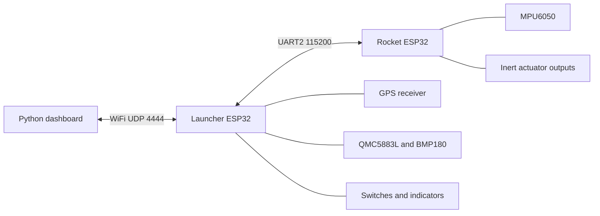

# Project 33: inert bench review setup

**Release status: HOLD.** This package is for software review and inert bench monitoring. Physical performance has not been validated. Field operation and live propulsion are outside the current release scope. See [release readiness](RELEASE_READINESS.md) for the unresolved engineering and procurement inputs.

## Package layout

The review distribution contains `firmware/rocket/` and `firmware/launcher/` compiled outputs when their builds succeed, `source/` with the reviewed source and documentation, `review/index.html` with the Evidence Observatory, `logs/` with build output, `openrocket-cache.json` with the saved simulated CP/CG trajectory, `release-review.json` with blockers, and `SHA256SUMS` with file digests. An ELF is a debugging artifact; a successful build does not establish board behavior. No devices are flashed during packaging.

The source directory excludes the private `wifi_config.h`, Python environment, raw local sessions, and PlatformIO caches. Local example WiFi credentials are for an isolated bench only. Build with your own local configuration before any approved hardware evaluation; record the configuration revision privately alongside the firmware digest.

## System layout



The PC joins the launcher's WiFi access point. The dashboard receives relayed telemetry, environment/status packets, and recovered rocket logs. Live `T` rows use the launcher relay clock; recovered `LOG` rows use the rocket clock. They are separate streams.

## Wiring reference for the current source

Confirm board and module labels against the complete [wiring reference](WIRING.md) before applying power. Use an inert assembly with no energetic material, keep ignition mechanisms mechanically disconnected, and leave the launcher switch in SAFE. GPIO 33 is an output, not a deployment-complete sensor. Size external actuator power for measured stall current; actuator power must not come from an ESP32 GPIO. Verify signal-level compatibility and share the signal ground.

```text
Launcher ESP32                          Rocket ESP32
GPIO 17 TX2 --------------------------> GPIO 16 RX2
GPIO 16 RX2 <-------------------------- GPIO 17 TX2
GND ----------------------------------- GND

Rocket I2C                              Launcher I2C
GPIO 21 SDA ---- MPU6050 SDA             GPIO 21 SDA ---- compass SDA + barometer SDA
GPIO 22 SCL ---- MPU6050 SCL             GPIO 22 SCL ---- compass SCL + barometer SCL
```

| Board | Connection | GPIO / setting |
|---|---|---|
| Rocket | Left, right, up, down canard signals | 26, 25, 27, 14 |
| Rocket | Ignition servo signal (mechanism disconnected) | 5 |
| Rocket | Deploy output (unloaded or instrument input only) | 33 |
| Launcher | GPS TX to ESP32 RX1 | 4; 9600 baud |
| Launcher | Arm switch, launch button | 5, 18; pull-up inputs, active LOW |
| Launcher | Status LED, buzzer | 23, 2; buzzer active LOW |
| Launcher | Interlock servo signal (mechanism disconnected) | 19 |

This is the implemented pin layout, not a finalized harness drawing. There are six servo outputs across both boards. The five-servo BOM and SG90/MG996R discrepancy remains D-021; do not use the $81 estimate as an as-built purchase total.

## Install and build

Use Python 3.11+ with Tk available. In the source directory, create an environment and install the pinned dashboard dependencies:

```text
python -m venv .venv
```

On Windows, use `.venv\Scripts\python.exe` for the following `python` commands, or activate `.venv\Scripts\Activate.ps1`. On Linux/macOS activate with `source .venv/bin/activate`.

```text
python -m pip install -r Firmware/requirements.txt
python Firmware/dashboard.py
```

Firmware rebuilds also need `python -m pip install -r Firmware/requirements-platformio.txt`. Copy `Firmware/Launcher/src/wifi_config.h.example` to the git-ignored `Firmware/Launcher/src/wifi_config.h` and set the local bench SSID/password. Then compile:

```text
python -m platformio run -d Firmware/Rocket
python -m platformio run -d Firmware/Launcher
```

For the full software review, also install `Firmware/requirements-test.txt` and `requirements-evidence.txt`, then run `python tools/finalize_release.py --output dist`. Use a new output directory for each run. This command compiles only and never uploads firmware.

## Monitor an approved inert session

1. A human confirms the inert setup against [Safety](SAFETY.md) and the applicable pre-registration. Preserve the local firmware binary digest, hardware identity, instrument settings and calibration records.
2. Join the access point named in the local WiFi header. The launcher gateway is `192.168.4.1`; UDP uses port `4444`. Permit Python through the local firewall for this bench network if required.
3. Start `python Firmware/dashboard.py`. Confirm the session ID, RAW SESSION label and data-quality counters appear. No telemetry yet means no data, not stable hardware.
4. Observe `T`, `STATUS`, `ENV` and quality counters. Stale heartbeat, invalid rows, missing altitude/GPS, clock regressions or gaps must remain in the record. A sent calibration command has no firmware acknowledgement.
5. Close the dashboard cleanly. Preserve the entire `Firmware/TestSessions/<session-id>/` folder, including `telemetry.csv`, `session.json`, and `commands.csv`. Raw sessions are git-ignored.
6. Follow [Bench Sessions](BENCH_SESSIONS.md) to declare provenance and build a passport. An independent instrument is needed for deploy timing; the telemetry dashboard cannot measure spring torque or laser line-of-sight error. A named human reviews actual captures and accepts applicable measurements.

Do not change interlocks or enable remote launch to obtain telemetry. This guide authorizes no arming, ignition, propulsion or field test. The current firmware contains command paths beyond monitoring; leave them unused during the monitoring workflow.

If no packets arrive, check the AP connection, IP/port, firewall, firmware revision and crossed UART connections first. If the GUI cannot start, verify Tk is installed in the Python environment. Preserve failed captures and their diagnostic output.

## Offline inspection and software fixture

Open the packaged `review/index.html` without hardware. From a trusted source checkout, verify it with `python -m evidence verify PATH_TO_REVIEW`. Integrity verification does not authenticate a reviewer or validate physical performance.

```text
python tools/generate_release_fixture.py --output build/synthetic-dashboard
```

This writes 201 invented dashboard-format samples and a synthetic passport. It opens no connection and sends no command. Read the generated `README.txt` before using it. It does not satisfy P-001/P-002/P-003 or create a P-006 measurement.
